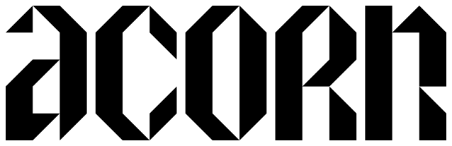
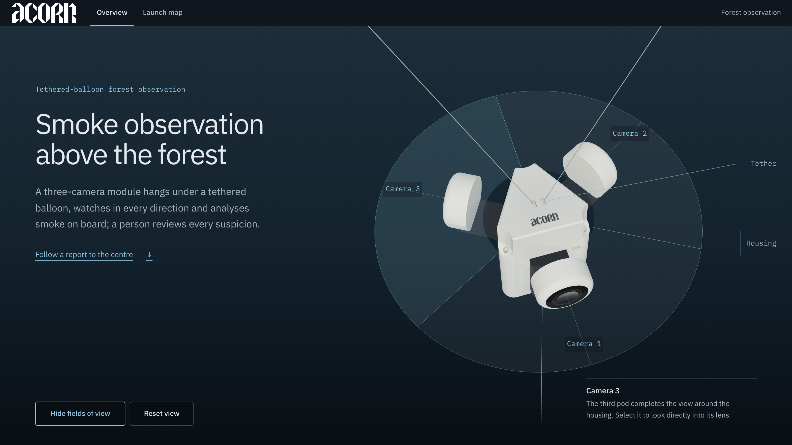
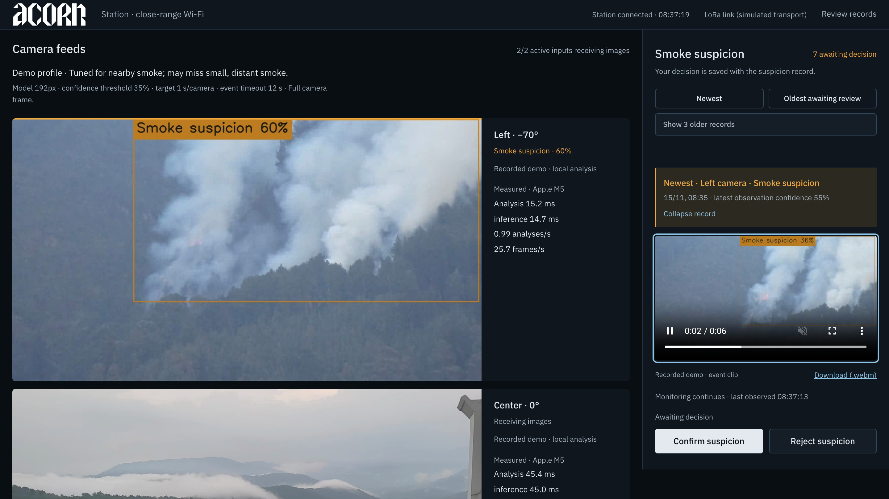
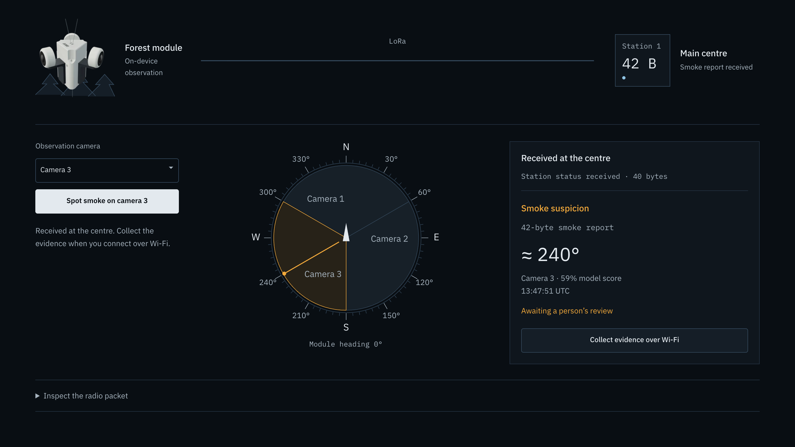
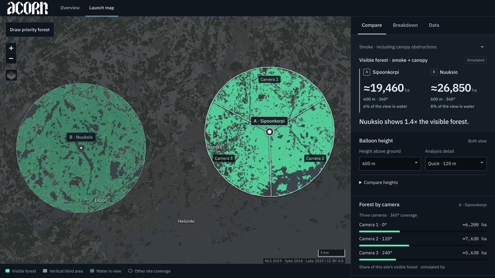
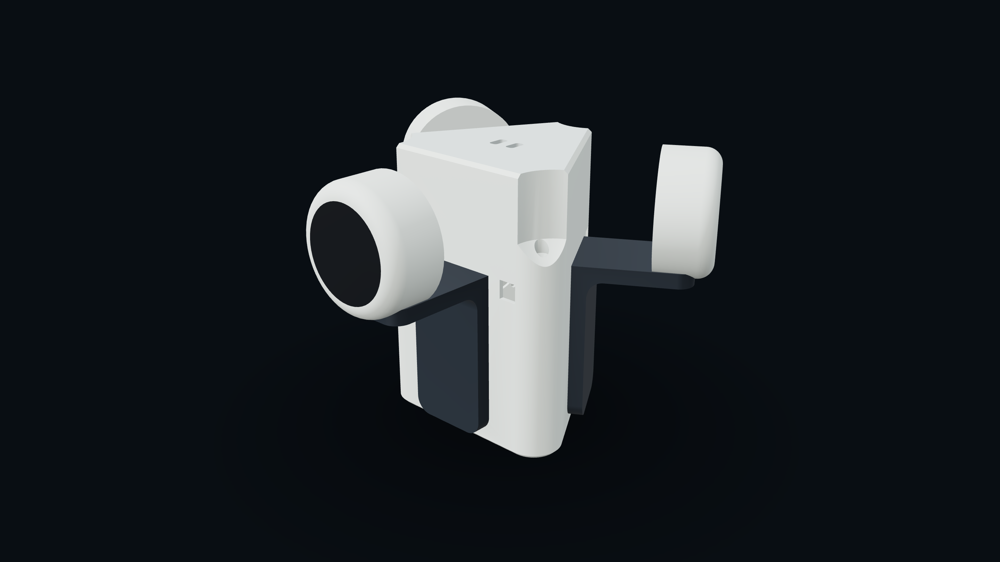

<h2 align="center">
  <picture>
    <source media="(prefers-color-scheme: dark)" srcset="assets/brand/acorn-wordmark-white.svg">
    
  </picture>
   
  Aerial Canopy Observation and Reporting Node
</h2>

ACORN (Aerial Canopy Observation and Reporting Node) is a portable forest observation station built by team Scarabs for the Green European Renaissance challenge at Junction 2026 in Helsinki. It is designed to run wildfire smoke detection on-device on an Arduino UNO Q with cameras; a placement tool estimates forest visibility across the Helsinki capital region.

  
   
  <a href="https://acorn-forest-watch.vercel.app">Live site: acorn-forest-watch.vercel.app</a>

| | |
|---|---|
|  **Station panel.** Camera feeds, smoke suspicion, evidence clip, Confirm or Reject. |  **LoRa report.** A 42-byte smoke report reaches the main centre with an approximate bearing. |
|  **Launch map.** Simulated visible forest from two launch sites, by camera. |  **Module.** Render of the housing CAD with its three camera pods. |

Screen recordings and more stills for every interface are in [`pitch/captures/broll/`](pitch/captures/broll/), with a manifest and contact sheet per surface.

- [`station/`](station/README.md): Python smoke detection pipeline and local web panel. See its README for setup and operation.
- [`placement/`](placement/README.md): Python line-of-sight analysis and offline map UI. See its README for data preparation and usage.
- [`ground/`](ground/README.md): LoRa-only remote dashboard for compact alert packets over simulated transport, with optional Wi-Fi evidence collection.
- [`tools/`](tools/README.md): upload and restore scripts for large artifacts kept in object storage, with a committed manifest. See its README for usage.
- [`firmware/`](firmware/README.md): MCU sketch designed for the Arduino UNO Q's local KY-026 flame sensor and RGB status LED, with wiring and bring-up instructions.

## What has been verified so far

- **Verified on the UNO Q:** the station has run with two live USB cameras through the kit's hub after a UVC driver bandwidth setting, the microcontroller bridge, the KY-026 flame sensor and the on-board status LED. At model input 192 with 320×240 cameras, measurements were about 278 ms inference, 0.99 analyses per second per camera, 180 MiB RAM, 42% CPU and 47°C peak. See the [board measurements](firmware/BOARD_NOTES.md).
- **Detection trade-off measured on a Mac:** input 192 detects a near plume but misses the same smoke shrunk two to four times in a synthetic proxy; input 640 still detects it, at a much lower analysis rate. The repository now separates a field profile (640 input, confidence 0.25, six-second interval) from a fast demo profile (192 input, confidence 0.35, one-second interval). The latest board configuration uses the demo profile with `detector_view = "center_crop"`. The six-second timing curve used confidence 0.35; performance of the exact new field profile remains unmeasured. See [analysis profiles](station/README.md#analysis-profiles) and [detection versus input size](station/DETECTION_VS_INPUT_SIZE.md).
- **Power-cycle recovery verified:** the owner powered the board off and back on; the station started automatically with both cameras and fresh sensor telemetry. An optional SSH tunnel must reconnect separately. Direct authenticated HTTP access on existing Wi-Fi was subsequently validated; the bind has not been browser or power-cycle tested. A later unexplained restart left the board unreachable; recovery remains to be checked. See [direct panel access](station/README.md#direct-panel-access-on-an-existing-wi-fi-network). See the [recovery record](firmware/BOARD_NOTES.md).
- **Live screen test on the UNO Q:** `center_crop` at input 192 / confidence 0.35 raised three smoke suspicions on the centre camera, peaks 0.62–0.76, about 3 s from first raw smoke response to suspicion. The hall camera stayed silent. This is a controlled screen demonstration, not field accuracy. See the [working recipe](DEMO.md#live-camera-screen-demonstration--working-recipe-2026-11-14).
- **Not yet verified:** access-point mode, the external RGB LED, real LoRa delivery, and field detection accuracy. One MicroMesh arrived but its variant and firmware remain unidentified; the link is still simulated.
- **Simulated, not measured:** placement coverage figures are geometric estimates, not a measured detection guarantee.

All three repository interfaces now default to English; Ground retains its Turkish toggle; the Placement website (Overview and map) is English only. The last recorded board deployment still had the Turkish station panel; deploying the English panel remains pending.

Supplied logo sources and offline usage are documented in [asset provenance](assets/brand/README.md).

Model weights, downloaded datasets, map tiles, source footage, and generated event evidence are kept out of git. The b-roll recordings under `pitch/captures/broll/` are the exception.

Use [DEMO.md](DEMO.md) for the demo runbook.
