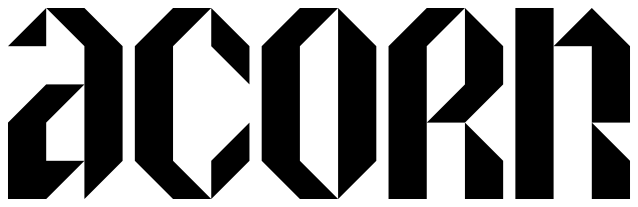

# ACORN launch point map

<p align="center">
  <picture>
    <source media="(prefers-color-scheme: dark)" srcset="../assets/brand/acorn-wordmark-white.svg">
    
  </picture>
  <br>
  Aerial Canopy Observation and Reporting Node
</p>

**ACORN — Aerial Canopy Observation and Reporting Node.** This is the English-first project website and offline geometric visibility simulator (Turkish toggle) for ACORN, built by team Scarabs for the Green European Renaissance challenge at Junction 2026, Helsinki. All implementation and generated data live in `placement/`; this app does not depend on `station/`.

**The two-camera input change is implemented.** The module carries three cameras at −70°, 0°, +70°, but normal requests allow at most two active cameras. The default is **left + centre**. The disconnected sector remains visible in grey as **“bağlı değil”**. Every primary metric, heading sensitivity and priority ranking uses only the active cameras. The three pairs are compared side by side; all three cameras are available only as **“üç kamera, referans”**.

Coverage is **simulated geometric visibility**, not optical smoke-detection range, probability of detection, fire prediction, smoke transport or smoke-model accuracy. A larger balloon height does not guarantee more hectares inside a fixed tilted camera frustum.

## Public website and artifact handoff

The landing page is now `/`; the existing live map is `/map`. Both use the same local/public backend. Identity (name, expansion, tagline, logo, team, event, challenge) is configured only in [`brand.json`](brand.json); the server renders it into both pages and `/api/brand`. The name stays English in Turkish. The header uses Yaman’s original vector wordmark (`logo`); the landing hero uses the complete stacked vector lockup (`stacked_logo`). Both are bundled under `static/brand/` for offline and deployed use. See [asset provenance and usage](../assets/brand/README.md). **Scarabs is the team**, not the product.

See [`DEPLOYMENT.md`](DEPLOYMENT.md) for the exact Modal token → one-time data load → deploy commands, public API limits, storage/JIT decisions and account-free checks. See [`../tools/README.md`](../tools/README.md) for the checksum-pinned IronShard dry-run/upload/restore workflow and redistribution notices. **No deployment or upload was performed.**

The blind-forest diagnosis and full 30/100/500/600/700 m results are in [`VERIFICATION.md`](VERIFICATION.md) and [`blind-audit.json`](blind-audit.json). At 600 m / 40 m resolution: Nuuksio blind forest is **14,431.68 simulated ha outside active FOV + 0.36 ha occluded inside it**; coast is **7,334.48 + 0.00 ha**. The low-height control shows strong occlusion. No height-insensitivity defect was found.

## Cold start

Prerequisites: Python 3.11–3.13, `uv`, and internet access for the initial dependency and raster downloads. Run these commands from this repository. Python 3.12 was used on this Mac; the project supports Python 3.11–3.13. `uv.lock` pins the environment.

```sh
cd placement
uv sync --frozen --python 3.12
uv run python scripts/prepare_data.py
uv run uvicorn forest_placement.api:app --host 127.0.0.1 --port 8787
```

Open **http://127.0.0.1:8787/**. No credentials or API key are needed for the selected public data mirrors.

After environment setup and data preparation, internet access is unnecessary:

```sh
uv run --offline --frozen uvicorn forest_placement.api:app --host 127.0.0.1 --port 8787
```

The preparation script uses a verified certifi CA bundle for urllib and GDAL, including the Syke certificate chain; TLS verification remains enabled. A byte-identical rebuild retains the pinned release timestamps in metadata.json while preparation-run.json records the actual run times.

Preparation downloads approximately 240 MB of regional raw rasters and produces approximately 32 MB in `data/prepared/`. The entire current data/cache directory is approximately 276 MB. To move the demo, copy the source code and `data/prepared/`; install Python dependencies before disconnecting. `data/raw/` is only needed for rebuilding. `data/results/` is recreated automatically. All large data, virtual environments and generated result images are ignored by `placement/.gitignore`.

Local mode leaves rate limiting off. `PLACEMENT_PRODUCTION=1` enables the public 90/client/minute and 360/global/minute limits; `PLACEMENT_RATE_LIMIT=1` or `0` explicitly overrides that choice. The single compute slot applies in both modes.

In ordinary laptop mode, the first visibility request may compile Numba code. Production/Modal mode warms the exact strided-array signature before accepting requests. Later requests use bounded disk cache results keyed by inputs, dataset checksums and algorithm version. Restart the server after preparing a different dataset: raster arrays are held in memory. Use one uvicorn worker for the laptop demo; API calculations are serialized to avoid competing CPU-heavy work.

## Data preparation and provenance

`scripts/prepare_data.py` downloads, clips, resamples/reprojects numeric data into **EPSG:3067 (ETRS-TM35FIN)**, records source URLs, access dates and prepared-file SHA-256 digests in `data/prepared/metadata.json`, and renders a local raster background in Web Mercator for Leaflet. All geometric analysis remains in EPSG:3067. Data obtained on **2026-11-13**:

| Dataset | Actual data used | Source and licence |
| --- | --- | --- |
| Elevation | **Real NLS Finland 10 m ground DEM**, public Paituli **2019 archive**, 28 GeoTIFF sheets. This is the intended national DEM, not Copernicus or synthetic terrain. | [Files and index VRT](https://www.nic.funet.fi/index/geodata/mml/dem10m/), [NLS product](https://www.maanmittauslaitos.fi/en/maps-and-spatial-data/datasets-and-interfaces/product-descriptions/elevation-model-10-m), [CC BY 4.0 terms](https://www.maanmittauslaitos.fi/en/opendata-licence-cc40). Attribution: contains National Land Survey of Finland Elevation model 10 m, 2019 snapshot, accessed 2026-11-13 through CSC/Paituli. |
| Land cover | **Real Syke CORINE Land Cover 2024 national 20 m raster**, published 2026-09-29, obtained through numeric WCS GetCoverage. Latest published release checked on preparation date. | [Syke catalogue](https://www.syke.fi/en/environmental-data/downloadable-spatial-datasets), [WCS](https://paikkatiedot.ymparisto.fi/geoserver/inspire_lc/wcs?service=WCS&request=GetCapabilities&version=1.1.0), [full 20 m download](https://wwwd3.ymparisto.fi/d3/Static_rs/spesific/Clc2024_FI20m.zip), [CC BY 4.0](https://www.syke.fi/en/environmental-data/use-license-and-responsibilities). Attribution: Syke, CORINE Land Cover 2024; includes contributing Finnish national data sources. |
| Tree height | **Real Luke MS-NFI 2023 numeric stand mean height**, native 16 m, decimetres converted to metres. Published 2025-10-22. Regional blocks downloaded using HTTP range reads. This is an estimated stand mean, not a LiDAR maximum canopy top. | [Numeric GeoTIFF](https://www.nic.funet.fi/index/geodata/luke/vmi/2023/keskipituus_vmi1x_1923.tif), [Luke product documentation](https://kartta.luke.fi/index-en.html), [2023 README](https://kartta.luke.fi/mvmi-inspire-metsavara-aineistot/README-2023.txt). **CC BY 4.0**, Natural Resources Institute Finland (Luke). |
| Canopy cover | **Real Luke MS-NFI 2023 numeric canopy-cover percentage**, native 16 m. Values 32766/32767 are missing/non-forestry codes, not valid heights or percentages. | [Numeric GeoTIFF](https://www.nic.funet.fi/index/geodata/luke/vmi/2023/latvuspeitto_vmi1x_1923.tif), [Luke Atom feed](https://kartta.luke.fi/inspireatom/MVMI-2023.xml). **CC BY 4.0**, Luke. |
| Buildings | **Not acquired.** CORINE built-up areas are on the background map but do not provide building heights. | Building obstruction is an explicit uncertainty. An optional numeric GeoTIFF loader is provided below. |
| Background map | Derived locally from the above real land-cover classes and elevation shading. Town/forest names are manually positioned orientation labels. No online basemap, road network or administrative boundary service is used. | Same underlying CC BY 4.0 attribution. |
| Browser map library | Leaflet **1.9.4**, JS/CSS/images/source map vendored in `static/vendor/`. | [Leaflet](https://leafletjs.com/), BSD-2-Clause, full notice in `static/vendor/LEAFLET-LICENSE`. |

The public CSC/Paituli mirror made the intended NLS data accessible without an NLS API key. **No Copernicus elevation fallback was necessary.** A newer local NLS DEM can replace the archived snapshot:

```sh
uv run python scripts/prepare_data.py --dem /absolute/path/to/nls_10m.tif
```

The supplied DEM must be a numeric georeferenced ground-elevation raster in metres with a valid CRS and nodata declaration. The loader reprojects it to EPSG:3067. Preserve its source and licence information when substituting data.

If Luke cannot be reached on another machine, the script fails plainly; it never silently invents a real-data layer. An explicit alternate scenario is available:

```sh
uv run python scripts/prepare_data.py --assumed-canopy
```

This assigns a **20 m opaque canopy to all CORINE forest**, labels it as an assumption in metadata/API/UI, and retains the bare-ground comparison. With the actual downloaded Luke data, **5.47% of CORINE forest cells** lack a valid height or cover value. Only those missing forest cells receive the explicitly labelled 20 m, 100% cover assumption. The other cells use numeric Luke estimates. This percentage describes the entire prepared region, not a candidate-specific uncertainty interval.

Optional measured building heights above ground, in metres:

```sh
uv run python scripts/prepare_data.py --building-heights /absolute/path/to/building_heights.tif
```

This takes the maximum of canopy and building height at each cell. No building dataset is bundled, and this optional import has not been exercised against a real building-height dataset. Supply/document the data licence and original URL when using it. Do not substitute a WMS image for numeric terrain, canopy or buildings.

## Model and outputs

The regional extent is a **75.12 km × 75.12 km rectangle**: `(345000, 6650000, 420120, 6725120)` in EPSG:3067. It covers Helsinki, Espoo, Vantaa, Kauniainen, Nuuksio, Sipoonkorpi, and the Helsinki–Espoo coast, plus surrounding land and sea. Metrics are within the candidate's range disk and this rectangle, **not clipped to municipal borders**. A warning appears if a disk reaches the data boundary. No missing-elevation land cells remain in the prepared data. NLS nodata over **CORINE-confirmed sea only** is filled with 0 m (472,641 native 20 m cells).

1. CORINE forest is national codes **3111–3133** (broad-leaved, coniferous and mixed forest, the 311/312/313 groups). Transitional woodland/clearcut classes `324*` are excluded. Water includes rivers/lakes/sea `51**/52**`; wetlands `41**/42**` and built-up `11**–14**` appear on the background. These definitions are reproducible classification choices, not a claim about all ecological forest land.
2. Native rasters are aligned to 20 m. Fast comparison uses **120 m** cells; detailed analysis uses **40 m** cells. Target forest/water areas retain the 20 m class fractions inside each analysis cell. Terrain and obstruction surfaces use conservative maximum-height aggregation. Coarse and detailed totals differ slightly because the range disk and polygons are sampled at cell centres.
3. Height is above the selected cell's ground estimate. Headings/yaw are clockwise from **EPSG:3067 grid north** (not magnetic/true north); positive tilt points down. Defaults: 600 m AGL, 10° downward tilt, 80° horizontal FOV, 50° vertical FOV, 12 km maximum range, smoke target 50 m above the obstruction/canopy surface. Camera geometry uses a full rectilinear 3D frustum, including tilt. The map sector guides show horizontal yaw/FOV only.
4. The default three physical yaw offsets span nominally about **220°** in total, with about 10° overlap between neighbours. Default active left+centre spans nominally about **150°**. Left+right has a **60° central gap and zero overlap** at default FOV. With changed FOV/tilt, actual overlap is recomputed, rather than forced to zero.
5. For each target cell, Numba samples the ray at intervals no greater than half an analysis cell, checking terrain and the opaque obstruction surface. Cell-constant heights, raster sampling and cell-centre target placement are approximations; this is not an exact solid-surface ray tracer. Observer and target cells are excluded as intermediate blockers. The target cell's own opaque canopy explicitly blocks its ground target. Unknown intermediate cells invalidate visibility.
6. Curvature subtracts `distance² / (2 × radius)` from terrain, obstruction and target heights in the observer tangent frame. The default radius is 6,371,000 m, configurable through the API. Atmospheric refraction is not modelled. This local spherical approximation is adequate for a prototype, not survey-grade geodesy.
7. Four separate scenarios are returned and selectable on the map: bare-terrain ground; bare-terrain elevated smoke; canopy-obstructed ground; canopy-obstructed elevated smoke. The elevated target remains at the same physical canopy/surface+smoke height in the bare comparison. Any positive measured canopy cover makes the height cell opaque; cover is not used as a linear visibility-probability multiplier. Ground under that opaque canopy is invisible, so **0 forest-floor hectares in the default connected views is an expected conservative result**, not proof that forest is absent.
8. A cell is counted **once** in the active-camera union. Overlap requires at least two active cameras to see it. Forest and water fractions contribute separate hectare totals; water contributes **zero forest target hectares**. Lines of sight can cross water. Water-view area and water share use the selected scenario's target-plane footprint (the smoke view therefore uses the elevated plane over water too). Select the ground scenario for a water-surface footprint. `blind_forest_ha` is the total unseen forest in the range disk. It is split into `outside_fov_forest_ha` (outside the active cameras’ union of full 3D frusta, regardless of line of sight) and `occluded_forest_ha` (in that union but not visible along the terrain/canopy ray). The target elevation is scenario-specific. The split is returned for every scenario, pair, reference and heading sensitivity; maps show outside FOV in grey and in-view occlusion in rust. With the current complete elevation grid, the latter is terrain/canopy obstruction; if unknown cells are introduced, it also includes unverified rays, explicitly warned via `unknown_forest_ha`. Neither split is a detection range.
9. The priority polygon is transformed from map lon/lat into EPSG:3067. Cells with centres inside it form the priority mask; only their visible **forest fraction** counts. Ranking is first by active-camera visible priority forest, then visible total forest, using the canopy-obstructed smoke scenario. No generic land/water polygon area is added to priority forest.
10. Heading sensitivity evaluates −20°, −10°, 0°, +10°, +20° with the **current active cameras**, full frusta and the same target/surface assumptions. Every possible pair and the three-camera reference reuse the same LOS result. The sensitivity chart and pair cards label all hectare figures **simülasyon**.

Buildings, camera calibration, actual balloon/tether motion, registration error, vegetation gaps/season, low smoke columns, haze, atmospheric refraction and illumination remain uncertainties. MS-NFI years, CORINE year and archived elevation year differ. Coarse views can smooth or exaggerate occlusion differently from detailed views. The main smoke view is more stable between resolutions than the bare forest-floor comparison; use detailed results for a selected site and inspect both scenarios.

## API

- `GET /`: jury landing page; `GET /map`: bilingual live map.
- `GET /api/brand`: shared project identity.
- `GET /api/config`: presets, availability, dataset provenance/assumptions.
- `POST /api/analyze`: one candidate, all four scenarios, connected-camera union, blind/overlap/water/priority metrics, pair comparison, three-camera reference, heading sensitivity, local map URLs, uncertainty and field checks.
- `POST /api/compare`: 2–6 candidates, results and priority-first ranking.
- `GET /maps/{filename}`, `/results/{filename}`, `/static/*`: allowlisted map/result PNGs and local UI assets. Numeric datasets, metadata and result JSON are not exposed as files.
- `GET /openapi.json`: local API schema. Swagger/ReDoc pages are disabled so no optional CDN assets can be requested.

Example (left+centre, remaining settings default):

```sh
curl -s http://127.0.0.1:8787/api/analyze \
  -H 'Content-Type: application/json' \
  -d '{"name":"Haukilahti","lon":24.773,"lat":60.159,"height":600,"heading":180,"resolution":"detailed"}'
```

For explicit camera settings, supply three `cameras` objects with `yaw`, `tilt`, `hfov`, `vfov`, `active`. A third active camera returns HTTP 422 unless `reference:true` is explicitly supplied. Reference mode is labelled throughout the response and UI. Invalid/self-crossing priority polygons, out-of-region locations and mostly-water launch cells are rejected. Launch validation at the working resolution is approximate and never replaces a site inspection.

## Demo sequence

1. Disconnect internet after preparation. Start on port 8787 and open the local page. Choose **Open the launch point map** on the landing page (or open `/map` directly). Switch to Turkish to follow the labels below. The initial map compares **Haukilahti** `(60.159, 24.773)`, heading **180°**, and **Nuuksio** `(60.293, 24.557)`, heading **20°**, both at 600 m. Left+centre are connected; right is grey **bağlı değil**.
2. Read the **duman · taç engelleri dahil** table. The south-facing coast spends about **84%** of its target-plane view over water; the inland preset about **7%**. Water is not forest target area. Click the inland tab to see its own cells/sectors.
3. Change height to 500/700 m, then choose **Ayrıntılı · 40 m** for a selected point. Select ground and bare-terrain scenarios to explain the canopy assumption.
4. At the coastal site, compare the three pair cards. Click **Sol + sağ**: the centre sector becomes grey, the central gap is visible and overlap becomes zero. Use **Merkez + sağ** if useful. Return to **Sol + merkez** for the baseline.
5. Turn on **Üç kamera, referans** to show the physically unachievable all-connected comparison. Turn it off before presenting the two-input production result.
6. Move the coastal heading from **180° to 0°**. The visible smoke-target forest changes from about **770 to 5,541 simulated ha** in the coarse pass. The API is rerun automatically. Expand the heading-sensitivity disclosure to inspect the ±10°/±20° chart.
7. Click **Öncelikli orman çiz**, click at least three corners near Nuuksio or Sipoonkorpi, then **Alanı tamamla** (or Enter). Candidates are reranked by visible priority forest. **Alanı temizle** resets it. Escape cancels an unfinished drawing. You can also click the map to move the selected candidate or enter coordinates directly.
8. Road access, shadow, site constraints and permission suitability are shown as **sahada doğrulanacak**. They are not computed or validated launch-site recommendations.

## Verification on this Mac

```sh
uv run pytest -q tests ../tools/tests
uv run python -m compileall -q forest_placement scripts
# In a second terminal while the server runs:
uv run python scripts/benchmark.py --fresh
```

The full placement and artifact suites pass with prepared real data. The expanded suite and production/browser checks are recorded in [`VERIFICATION.md`](VERIFICATION.md). One upstream Starlette/httpx deprecation warning remains. Tests cover flat terrain, a blocking ridge, curved-earth horizon, canopy/unknown blockers, 3D frusta and boundaries, unique union/overlap counting, water exclusion, empty active sets, priority counting/ranking, max-two validation, three-camera reference, pair gaps/overlap, real data for both presets at both resolutions, heading changes, API responses, local assets, cache invalidation by inputs and fresh analysis with socket access blocked.

The server was actually started and both presets were called over HTTP at **500/600/700 m in both resolutions**. `scripts/benchmark.py --fresh` first performs uncached calculations with the same engine and then verifies their live API responses; it records compute and HTTP response times separately. Timings include metric aggregation, all pair/reference and sensitivity comparisons, and four warped PNG overlays. They exclude initial package install, data preparation and cold Numba compilation. The machine reports **macOS 27.0.1, arm64, 10 logical CPUs**, Python 3.12.10.

A shared-browser check loaded the page and verified the rendered numbers, grey disconnected sector, disabled third input, heading update, pair switch, and priority polygon. The recorded page resource URLs were **all same-origin localhost**, with zero external resource requests. Fresh engine analyses also passed while socket connection functions were blocked. The Mac's physical Wi-Fi/network interface was **not disabled** during the check. No cloud tile service, CDN/font request, analytics, API key or WMS image is required at runtime. CSP permits same-origin connections only.

Full numerical results, including every scenario, all pairs, reference and sensitivity values for all heights/resolutions, are committed as the small report artifact [`benchmark-results.json`](benchmark-results.json). Human-readable tables are in [`VERIFICATION.md`](VERIFICATION.md). Large real rasters stay out of git.

## Known limits / not verified

- No real building-height dataset acquired; building obstruction is omitted. The optional import is implemented but not validated against real buildings.
- Road access, shadow, ground/tether suitability, airspace permission and site constraints are explicitly **field checks**, not computed.
- No optical detection, smoke dynamics, camera calibration, refraction, visibility/weather or actual field validation. These are outside the geometric prototype.
- The 2019 DEM is real but older than current NLS updates. A current local NLS file can be loaded; that alternative was not exercised.
- Luke missing forest data (5.47%) uses a clearly disclosed 20 m opaque-canopy assumption. Opaque mean-height cells may overstate or understate real canopy blocking. No uncertainty confidence interval is claimed.
- The fully assumed `--assumed-canopy` option and real building-height import were not used in the delivered benchmark. No Copernicus fallback was exercised or needed.
- No municipal administrative clipping or offline road labels. Counts are regional rectangle/range-disk counts. Priority boundaries and range circles use analysis-cell centres.
- No physical internet-disconnection test; runtime socket blocking and same-origin browser inspection were performed instead.
- Browser state is in memory; refresh resets candidates and drawn priority polygons. Server results are capped at 256 analyses; Modal results are ephemeral and disappear on container recycle.
- Python 3.11/3.13 and other operating systems were not run; verified runtime is this Mac on Python 3.12.

Board status: the station has run on a real UNO Q using recorded clips, the MCU bridge, KY-026 and on-board status LED. This does not validate placement visibility or field detection range. Board inference performance for the demo, USB cameras, AP mode, external RGB LED and real LoRa radio remain unverified; see [BOARD_NOTES.md](../firmware/BOARD_NOTES.md) for ongoing bring-up work.
